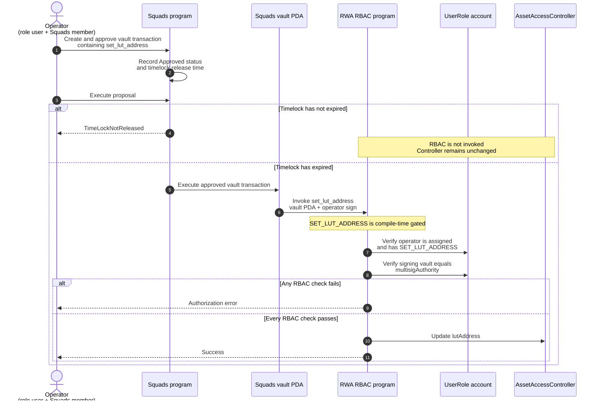

# Squads timelock demo

For the architectural comparison and recommended production model, see
[Timelock gating design decision](./TIMELOCK_GATING_DESIGN.md).

## How the gated operation works

`SET_LUT_ADDRESS` is included in the program's compile-time `GATED_ADMIN_FLAGS`.
Unlike an ordinary admin operation, it cannot be authorized by the controller admin
alone: the role user and the role's configured multisig authority must both sign.



The two layers have separate responsibilities:

1. **Squads** enforces membership, approval threshold, and the timelock.
2. **RBAC** enforces role membership, `SET_LUT_ADDRESS`, and the exact configured
   vault signer.

Approval therefore does not bypass the delay, and an expired timelock does not
bypass RBAC authorization. Both layers must pass for the state change to occur.

Start Anchor's Surfpool localnet in the first terminal:

```sh
anchor localnet --ignore-keys -- --features localnet
```

Then run each command from the repository root in a second terminal:

```sh
yarn exec ts-node tests/timelocks-demo-scripts/00-initialize.ts
yarn exec ts-node tests/timelocks-demo-scripts/01-create-controller.ts
yarn exec ts-node tests/timelocks-demo-scripts/02-create-role.ts
yarn exec ts-node tests/timelocks-demo-scripts/03-create-multisig.ts
yarn exec ts-node tests/timelocks-demo-scripts/04-configure-role.ts
yarn exec ts-node tests/timelocks-demo-scripts/05-create-proposal.ts
yarn exec ts-node tests/timelocks-demo-scripts/06-execute-proposal.ts
yarn exec ts-node tests/timelocks-demo-scripts/07-advance-clock.ts
yarn exec ts-node tests/timelocks-demo-scripts/06-execute-proposal.ts
```

The first execution attempt demonstrates `TimeLockNotReleased`. Run the same execution script again after advancing the clock to execute the proposal.

Every mutation script fetches and prints the state it created or changed. You can also inspect everything that currently exists after any step; accounts that have not been created yet are skipped automatically:

```sh
yarn exec ts-node tests/timelocks-demo-scripts/show-state.ts
```

The default RPC URL is `http://127.0.0.1:8899`. Override it with `RPC_URL`. The default timelock is 60 seconds; set it while initializing with, for example, `TIMELOCK_SECONDS=20`.

`00-initialize.ts` starts a fresh demo and overwrites `.timelock-demo-state.json`. That file contains throwaway local keypairs and must never be used outside local testing.
